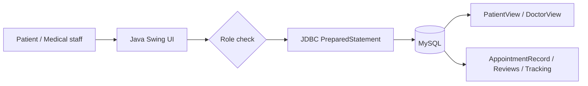

# DByte

Java Swing과 MySQL/JDBC로 구현한 **의료 데이터 관리 학업 프로젝트**입니다. 환자와 의료진의 역할에 따라 기관 검색, 리뷰, 상담 기록과 건강 추적 데이터를 조회·등록·수정·삭제합니다.

## 프로젝트 정보

| 항목 | 내용 |
|---|---|
| 기간 | 2025.05 - 2025.06 |
| 인원 | 4인 팀 프로젝트 |
| 담당 | 프로젝트 초기 구조, 건강 tracking CRUD·ROLLUP, 메인 GUI와 기능 통합, 상담 기록 콘솔 흐름 개선 |
| 기술 | Java, Swing, MySQL, JDBC |
| 상태 | DB schema·migration·seed와 build 설정이 없어 현재 저장소만으로는 완전 재현 불가 |

## 핵심 기능

| 기능 | 구현 내용 | 근거 |
|---|---|---|
| 역할별 상담 기록 | 환자는 본인 기록, 의료진은 소속 기관 기록을 별도 VIEW로 조회 | [`AppointmentRecordsql.java`](source/AppointmentRecordsql.java) |
| 처방 안전 확인 | 상담 기록 등록·수정 전에 환자 알레르기와 처방 문자열 대조 | [`AppointmentRecordsql.java`](source/AppointmentRecordsql.java) |
| 기관 리뷰 | 리뷰 CRUD, 기관·사용자별 집계, 기관 평균과 순위 | [`InstitutionReview.java`](source/InstitutionReview.java) |
| 건강 추적 | 기분·수면·운동 기록 CRUD와 사용자별 평균 집계 | [`Tracking.java`](source/Tracking.java) |
| 데스크톱 UI | 로그인 역할에 따라 상담·리뷰·트래킹 메뉴 분기 | [`MainGUI.java`](source/MainGUI.java) |

## 구조



화면에서 받은 값은 `PreparedStatement` 파라미터로 전달합니다. 상담 기록 조회는 사용자 역할을 먼저 확인하고, 환자는 `PatientView`, 의료진은 소속 기관 기준 `DoctorView`를 사용합니다.

## 개인 기여

| 영역 | 구현 | 근거 |
|---|---|---|
| 건강 추적 | tracking CRUD와 `WITH ROLLUP` 사용자·전체 평균 집계 | [`06dd5da`](https://github.com/Westyoon/DByte/commit/06dd5da) |
| UI 통합 | `MainGUI` 생성, 로그인 상태와 역할별 메뉴 구조 통합 | [`05e6504`](https://github.com/Westyoon/DByte/commit/05e6504) |
| 상담 기록 | 콘솔 기반 조회·등록 흐름과 역할 분기 개선 | [`654c393`](https://github.com/Westyoon/DByte/commit/654c393) |

개인 기여 이력은 [Westyoon의 커밋](https://github.com/Westyoon/DByte/commits/main/?author=Westyoon)에서 확인할 수 있습니다.

## 팀 트러블슈팅

아래는 프로젝트 전체의 문제 해결입니다. 개인 기여와 혼동되지 않도록 각 구현 근거를 함께 표시했습니다.

### 1. 상담 기록 수정에서 알레르기 검사가 잘못된 ID를 사용했습니다

- **문제:** 등록 경로와 달리 수정 경로에서는 환자 알레르기 충돌을 안정적으로 확인하지 못했습니다.
- **원인:** 처방 검증에 필요한 환자 ID 대신 상담 기록 ID 흐름에 검사가 묶여 있었습니다.
- **검토:** 화면에서 환자 ID를 다시 넘기는 방식과, 서버 로직에서 상담 기록으로 환자를 조회하는 방식을 비교했습니다.
- **적용:** `appointmentId`로 `AppointmentRecord.userId`를 먼저 조회한 뒤 해당 환자의 알레르기와 처방을 대조했습니다.
- **결과:** 등록과 수정 모두 환자 ID를 기준으로 같은 검증 경로를 사용하게 됐습니다.

관련 코드: [`getPatientIdFromAppointment`](source/AppointmentRecordsql.java)

이 수정은 팀원 aJISUa의 [`3f9871e`](https://github.com/Westyoon/DByte/commit/3f9871e) 커밋에서 확인할 수 있습니다.

### 2. 환자와 의료진의 조회 범위가 달랐습니다

- **문제:** 같은 상담 기록 화면에서도 환자는 본인 기록만, 의료진은 소속 기관 기록을 봐야 했습니다.
- **원인:** 사용자 ID 하나만으로 조회하면 의료진의 기관 범위를 표현할 수 없었습니다.
- **검토:** 단일 쿼리에 조건을 누적하는 방식과 역할별 VIEW를 분리하는 방식을 비교했습니다.
- **적용:** 환자는 `PatientView`를 사용자 ID로, 의료진은 소속 기관을 조회한 뒤 `DoctorView`를 기관 ID로 조회했습니다.
- **결과:** 화면 분기와 SQL 접근 범위를 같은 역할 규칙으로 맞췄습니다.

### 3. 리뷰 평균과 기관 순위를 여러 쿼리에서 중복 계산했습니다

- **문제:** 리뷰 목록, 기관 평균, 순위를 따로 계산하면 같은 집계 로직이 반복됐습니다.
- **원인:** 행 단위 리뷰와 기관 단위 통계를 한 결과에서 함께 보여줘야 했습니다.
- **적용:** CTE에서 `AVG(...) OVER (PARTITION BY institution_id)`를 계산하고, 바깥 쿼리에서 `RANK()`를 적용했습니다.
- **결과:** 한 번의 조회로 리뷰, 기관 평균과 순위를 함께 반환하도록 정리했습니다.

CTE와 window function 구현은 팀원 Alimeeeeeee의 코드이며, 현재 [`InstitutionReview.java`](source/InstitutionReview.java)에서 확인할 수 있습니다.

## 실행 전 확인

이 저장소에는 Java 소스만 있고 다음 항목이 포함되어 있지 않습니다.

- MySQL table·VIEW 생성 스크립트와 seed data
- Maven/Gradle build 설정과 JDBC driver 선언
- 패키지 구조를 재현하는 프로젝트 설정
- 자동 테스트와 환경 변수 예시

따라서 현재 상태에서는 실행 명령을 임의로 제시하지 않습니다. 재현 가능한 버전으로 만들려면 schema와 seed를 먼저 복원하고, 소스의 DB 접속 정보를 환경 변수로 이동한 뒤 build 설정과 테스트를 추가해야 합니다.

## 한계와 개선 계획

- DB 접속 정보가 소스에 하드코딩되어 있어 환경 변수 또는 별도 설정 파일로 분리해야 합니다.
- 알레르기 검사는 `allergy.contains(prescription)` 형태라 비교 방향과 복수 처방 parsing을 다시 검증하고, 의약품 코드 기반 검사로 보완해야 합니다.
- 리뷰 행마다 같은 기관 평균이 반복된 상태에서 `RANK()`를 적용해 다음 기관 순위가 리뷰 수만큼 건너뛸 수 있습니다. 기관 단위 subquery 또는 `DENSE_RANK()` 검토가 필요합니다.
- GUI 일부 버튼은 화면만 연결되어 있고 실제 handler가 비어 있습니다.
- 역할 판정이 ID 범위에 의존하므로 사용자 역할 컬럼과 권한 검사를 DB에서 관리해야 합니다.
- schema·seed·자동 테스트를 추가하기 전까지는 완성 서비스가 아닌 데이터베이스 수업용 prototype으로 봐야 합니다.

## Repository structure

```text
source/
├─ AppointmentRecordsql.java  상담 기록 SQL과 권한·알레르기 검사
├─ InstitutionReview.java     리뷰 CRUD와 집계·window query
├─ Tracking.java              건강 추적 CRUD와 ROLLUP
├─ MainGUI.java               역할별 Swing 메뉴
└─ ...                        검색·리뷰·상담 화면과 model
```
